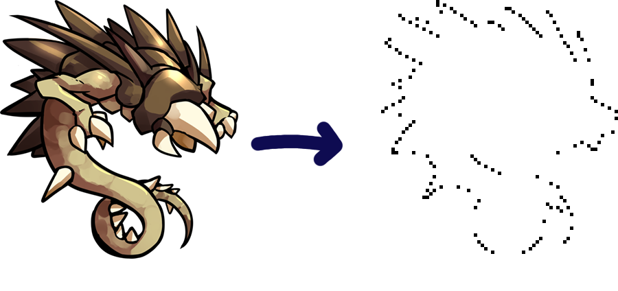

# Contour

Programme to output a low-resolution corner contour (in the form of a list of
coordinates for use with Godot, but also optionally as an actual image)
based on a 2D image.
Intended to be used as the input for a program which converts the coordinates
into a 3D mesh.

It's essentially a way to make a basic collision box out of a 2D sprite. Hence
the low resolution and disinterest in finding *all* corners, much less keeping
all edges: The resulting convex collision shape would be more computationally
expensive to use than necessary (for my purposes).

## Dependencies

Requires the Pillow library.

## Setup

I recommend just using `uv`, but if you prefer not to, you will need to install pillow with

```
pip install pillow
```

## Usage

There are currently no command-line arguments to change scaling or format.

```
uv run contour.py <filename>
```

or

```
py contour.py <filename>
```

## Example

Below is seen an example of the programme's output. The input image was resampled to
20% of its original size. In the illustration, the 'after' image has therefore been
scaled up by 500% (nearest neighbour algorithm). The background is made white to make it easier to see the output.



## How it works

Imagine that for each edge pixel in the image, the algorithm moves inward and stops at the first non-transparent pixel it encounters. If this pixel is a corner (or the edge of the image), it is kept in the output.